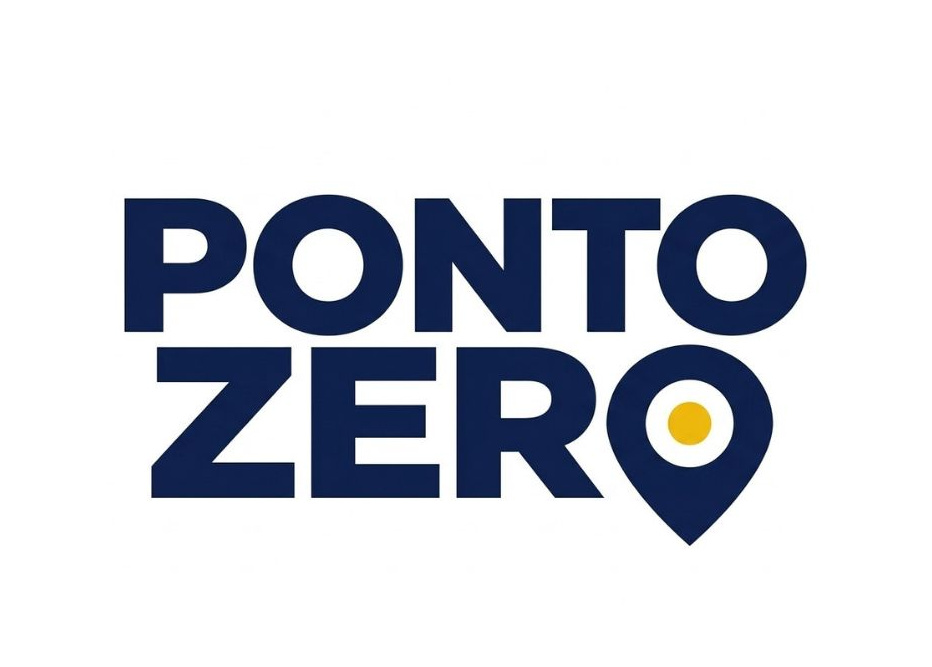

  
  <h1> Ponto Zero — Mapa Vivo de Oportunidades </h1>

  
  <h3> Sobre o Projeto </h3>
  
    

A Ponto zero  é uma plataforma que centraliza e organiza dados territoriais para identificar e comparar regiões com maior potentcial comercial. 
O objetivo do produto é permitir que redes de franquias, pequenas e médias empresas analisem e comparem o potencial comercial de diferentes bairros e regiões em questão de minutos, reduzindo riscos financeiros e acelerando a tomada de decisão.

    
  
  <h3> Problema e Oportunidade </h3>
  
    

  

Abertura de novas unidades físicas exige investimentos elevados e envolve grandes incertezas por parte dos empresarios e gestores.

- Job: Identificar e priorizar regiões para expansão comercial com base no potencial de mercado.
- Dor: Dificuldade de análisar dados e na tomada de decisão.
- Ganho: Realizar uma análise inicial mais clara , ágil e com críterio

    
  
  <h3> Arqutetura do Projeto </h3>
  Adicionar futuramente
   

  

    
  
  <h3> Modelagem de Banco de Dados </h3>
  Adicionar futuramente
  
   

  
